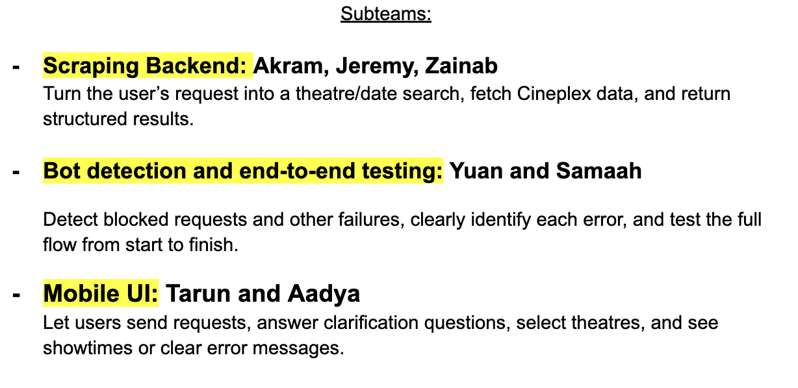

# 301 warriors - Group 2

 > _Note:_ This document is meant to be written during (or shortly after) your review meeting, which should happen fairly close to the due date.      
 >      
 > _Suggestion:_ Have your review meeting a day or two before the due date. This way you will have some time to go over (and edit) this document, and all team members should have a chance to make their contribution.

## Iteration XX - Review & Retrospect

 * When: FILL IN THE DATE WHEN YOU ACTUALLY HAD YOUR REVIEW MEETING
 * Where: PHYSICAL LOCATION AND/OR ONLINE

## Process - Reflection

#### Q1. What worked well

1. **Forming subteams around related tasks.** We divided ourselves into three subteams based on closely connected responsibilities. This made it easier for teammates to coordinate changes, review each other’s code, and agree on data formats before combining their work. Working in smaller groups helped reduce misunderstandings and integration conflicts while allowing different parts of the project to progress simultaneously.

2. **Holding regular internal team meetings.** We decided to meet as a team, without the partner or TA, at least once a week to divide tasks, clarify uncertainties, and set timelines. Meetings before demos were particularly useful for reviewing progress and confirming what was ready to present. This helped everyone stay aligned and identify blockers before they became surprises during the demo.

3. **Integrating related components in stages.** We combined closely related pieces first, such as the backend client and discovery worker, before connecting them to the frontend. This gave us smaller integration steps to review and test, making it easier to identify where mismatches originated. It also allowed teammates to begin connecting their components while other parts were still being completed.

#### Q2. What did not work well

1. **Assigning broad tasks without clear individual ownership.** Initially, multiple teammates worked on the same broad task without clearly defined responsibilities. This created misalignment about who was implementing each part and how the pieces would fit together. Dividing the work into seven smaller subtasks improved this process by giving each member clear ownership and a manageable section of code to understand and maintain.

2. **Leaving some integration details unclear before implementation.** We did not fully agree on certain data formats and component interactions before starting development. When connecting our work, we needed additional clarification about how backend results would reach the frontend and how information would pass between components. This caused rework and extra coordination. Agreeing on shared interfaces and example inputs and outputs beforehand would have made integration smoother.

#### Q3(a). Planned changes

1. **Establishing a clearer branching, review, and integration workflow.** We plan to define which shared branches individual task branches should merge into, the order of merges, and the reviews and tests required before each merge. We will also set deadlines for completing individual work, integrating components, and testing the combined system. This should reduce merge conflicts and confusion about which branch contains the latest changes, while leaving enough time to address integration issues.

2. **Allowing members to rotate responsibilities between sprints.** Although we divided tasks among frontend, backend, and testing teams, the assignments did not offer equal technical scope or always match members’ interests. For the next sprint, we plan to let members express their preferences and switch areas where feasible, while accounting for dependencies and sharing knowledge during handoffs. For example, someone who took on frontend work for D2 could contribute to backend development in D3. This would distribute learning opportunities more fairly and help members gain experience across the system.

#### Q3(b). Integration & Next steps
Briefly explain how you integrated the previously developed individuals components as one product (i.e. How did you split the work across your team) and how was the work integrated together.

 * Keep this very short (1-3 lines).

## Product - Review

#### Q4. How was your product demo?
 * How did you prepare your demo?
 * What did you manage to demo to your partner?
 * Did your partner accept the features? And were there change requests?
 * What were your learnings through this process? This can be either from a process and/or product perspective.
 * *This section will be marked very leniently so keep it brief and just make sure the points are addressed*
