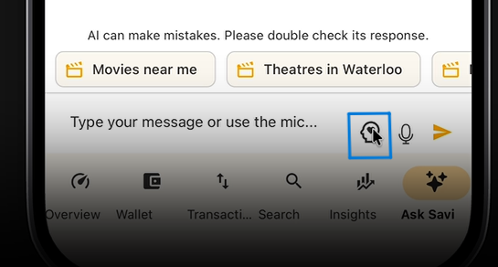

# 301 Warriors

**NOTE**: the partner’s repo already had a D2 tag pointing to unrelated work, so the submission is tagged 301-warriors-D2. here’s the snapshot link: https://github.com/cheapreats/ce/tree/301-warriors-D2
​
## Partner Intro
**Partner Organization**: Savi Finance

**Primary Point of Contact**: 
 * Name: Ralph Maamari
 * Email: ralphpalxyz@gmail.com
 * Title: Co-founder and CEO of Savi Finance
 * Role: Primary Point of Contact

**About the Partner Organization**:

Savi Finance is a Toronto-based personal finance technology company focused on helping people take control of their financial future. Its platform brings financial accounts, spending insights, goals, and planning tools together in one place, with AI-powered features designed to make financial management simpler and more accessible.

## Description about the project

Our project introduces an AI-powered Cineplex booking concierge as a new feature within Savi Finance. Users can request for movie bookings, set their preferences, and easily explore movie options, all through a natural conversation. The agent handles everything from interpreting your request to confirming the final booking details.

This feature aims to replace the repetitive and time-consuming nature of traditional movie booking by reducing the need to manually navigate through the Cineplex website while still giving the user full control of the payment/booking process.

[View our interactive mockup](deliverables/D1/mockup.md)
​
## Key Features
### Conversational Movie Booking
Users can describe the movie experience they want in natural language. Savi interprets the request, combines it with relevant saved preferences, and proposes a suitable booking.

### Personalized Booking Preferences
Savi can remember preferences such as a user's usual ticket quantity, theatre, movie format, and seating preferences. Users can always review and override remembered information for an individual booking.

### Movie, Showtime, and Seat Selection
Users can review or modify the recommended movie, theatre, format, showtime, ticket quantity, and seats. Savi can also suggest seats based on the user's seating preferences.

### Review, Checkout, and Tickets
Before payment, users can review the complete booking and make changes. After a successful booking, Savi displays the booking confirmation and digital ticket information.

### Recurring Auto-Booking
Returning users can save recurring movie-going preferences. Savi can use these preferences to prepare a booking proposal that the user can modify, approve, or skip.

### Group Booking Coordination
Users can invite friends to a booking by Savi username or email. Savi can track participant confirmations and help coordinate whether the organizer waits, proceeds alone, purchases all tickets, or sends split-payment requests.

### Coupons, Vouchers, and Credits
During checkout, Savi can surface eligible savings from both authorized connected email accounts and Savi-provided offers. Users choose which eligible savings to apply before payment.

## Key Use Cases

The current version of this project supports the following use cases:
1. **Movie discovery**: Find movies currently playing at Cineplex theatres near a specified location (i.e. user's location) and date.

2. **Filter movie options**: Search by genre, new releases, format (IMAX or UltraAVX), occasion, or preferred time.

3. **Find and select showtimes**: View and select available movies and showtimes for a selected theatre and date.

4. **Refine requests conversationally**: Change the location, date, theatre, movie, or time without restarting the search.

5. **Remember preferences**: Save preferences such as a usual theatre, favourite genres, preferred format, or viewing time.

6. **Start a new request**: Reset the current search and begin a new movie discovery request.

**Left**: shows a simple user request and the search results based on the request. 

**Right**: shows the user setting their preferrences for the agent to remember for future bookings. 

Use cases such as ticket purchasing, reserving seats, and checkout are NOT included in this version. 

## Instructions for use

The Cineplex feature is only available through the Savi Finance **mobile** app.

### 1. Install or open Savi Finance

On your phone, install Savi Finance from the appropriate app store:

- [Download for iPhone or iPad](https://apps.apple.com/us/app/savi-finance/id1672669909)
- [Download for Android](https://play.google.com/store/apps/details?id=com.centro.savi)

If you already have the app installed, update it before testing the feature.

### 2. Sign in

1. Open the Savi Finance app.
2. Select **Sign in**.
3. Enter your email address.
4. Complete the sign-in instructions sent to your email.
5. Wait until the main Savi Finance screen appears.

Ask Savi requires an eligible paid plan. If you see an **Unlock Ask Savi with Pro** message instead of the chat, the account does not currently have access.

### 3. Open Ask Savi

There are two ways to open it:

- Select the **Ask Savi** tab in the app.
- From the home screen, tap the **Ask Savi** shortcut if it is displayed.

You should see a conversation screen with a text box at the bottom.

### 4. Start a movie request

Type a movie request, such as:

> Book me a movie for tomorrow.

You may also see suggested buttons such as:
- "Movies near me"
- "Theatres in Waterloo"
- "Movies tonight"
- "Pick a movie for me"

Tap one of these buttons to send a ready-made request, or type your own request.

### 5. Answer the follow-up questions

Ask Savi may ask for information such as:

- Your city or neighbourhood
- The date you want to go
- Your preferred movie
- A preferred theatre
- A preferred time
- A movie format, such as IMAX or UltraAVX

Here is an example of a natural conversation with the Ask Savi agent:

1. **User:** “Find me a movie tomorrow.”
2. **Ask Savi:** “Which city or area should I search?”
3. **User:** “Toronto.”
4. **Ask Savi:** “The date is October 21, 2026. Is that correct?”
5. **User:** “Yes, that works.”

Ask Savi remembers and clarifies the details from earlier messages in the same conversation, so you do not need to repeat information you have already provided.

### 6. Review the results

Ask Savi searches available Cineplex theatres and showtimes, then presents the relevant options.

You can either: 
- Manually select the theatre and showtime from the given list of options **OR**
- Respond with your selection such as:

    > The second theatre.

    or:

    > Show me the 6 PM options.

You can always change the search or include additional details to filter the search.

### 7. Save movie preferences

You can set your preferences by clicking on little icon next to your typing bar.

You may save preferences such as:

- Your usual theatre
- Preferred format, such as IMAX or UltraAVX
- Favourite genres
- Preferred time of day

These preferences can help Ask Savi make future movie searches more relevant.

### If the feature does not appear

Check the following:

1. Confirm that you are using the latest version of the Savi Finance app.
2. Confirm that you are signed in.
3. Confirm that your account has Ask Savi access.
4. Close and reopen the app.
5. Start a new Ask Savi conversation.
6. If the movie suggestions or movie search still do not appear, the feature may not yet be enabled in the deployed production version for your account.

## Development requirements
### Technology Stack

The current partner-confirmed stack includes:

- **Mobile:** React Native, TypeScript, Expo, Styled Components
- **Backend / SF1 API:** Go, MongoDB
- **Browser Automation:** Browserbase, Playwright
- **Chrome Extension:** HTML, CSS, JavaScript
- **Other option discussed with partner:** Computer Use

The existing Cineplex browser-worker also uses infrastructure including Bazel, Redis-based execution coordination, and browser automation abstractions.

### Local Development

A developer will require access to the Savi codebase and the services/configuration supplied by the partner.

## Deployment and Github Workflow

### GitHub Workflow
​The team uses `main` as the stable integration branch. Development work is completed on separate branches rather than directly on `main`.

Branches follow the convention:

- `feat(cineplex): <feature-name>` for new functionality
- `fix(cineplex): <issue-name>` for bug fixes
- `docs(cineplex): <change-name>` for documentation changes

When a task is ready:

1. The developer pushes their branch to GitHub.
2. The developer opens a pull request from their branch into `main`.
3. At least one other team member reviews the pull request.
4. The author resolves requested changes and merge conflicts.
5. Relevant tests must pass before the pull request is merged.
6. Approved changes are merged into `main`.

### Deployment

The release flow is:

`Development Branch → Pull Request → Review & Testing → main → Deployment`

Only reviewed code merged into `main` should be eligible for deployment.

 ## Coding Standards and Guidelines
 
We follow idiomatic Go and TypeScript/React Native conventions, use descriptive naming, keep components and functions focused, and follow the existing structure of the Savi codebase. Code should be formatted and linted using the tools configured in the relevant repository, and new functionality should include appropriate testing where feasible.
​
 ## Licenses
​
This project uses the **MIT License** for code authored by the CSC301 team. We chose MIT because it is a simple and permissive license that allows others to use, modify, and distribute our code while preserving attribution and the original license notice.

This license applies only to code owned by the student team. Any pre-existing Savi Finance code, third-party libraries, or external dependencies remain subject to their original licenses and ownership terms.

## Deployed URL / Access Instructions

**Not deployed yet.**

Here is a link to a demo of the app: https://drive.google.com/drive/folders/1O4-SBhU0E2u_yQp2FOtGiVEq8jyFI5Ef?usp=sharing

## D3 Improvement Highlight

**Not there yet.**
