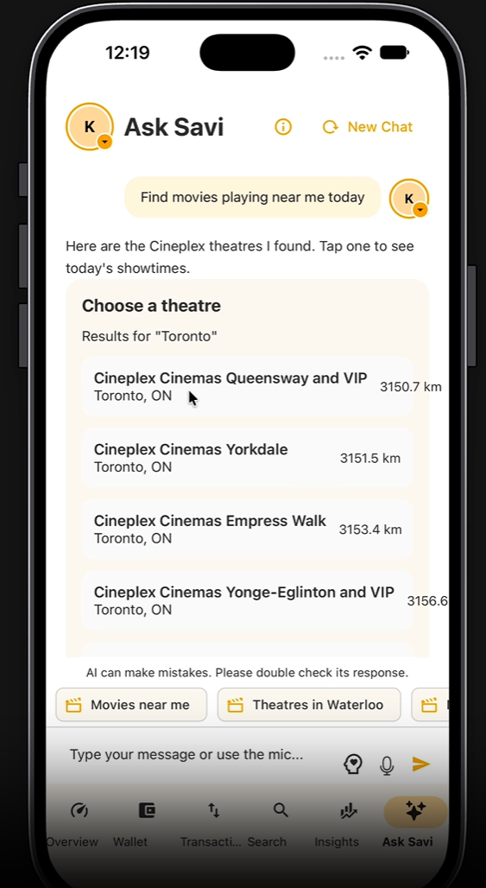
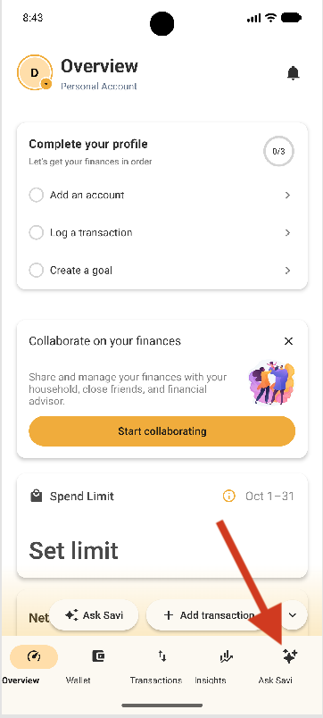

# 301 Warriors

**NOTE**: the partner’s repo already had a D2 tag pointing to unrelated work, so the submission is tagged 301-warriors-D2. here’s the snapshot link: https://github.com/cheapreats/ce/tree/301-warriors-D2
​
## Partner Intro
**Partner Organization**: Savi Finance

**Primary Point of Contact**: 
 * Name: Ralph Maamari
 * Email: ralphpalxyz@gmail.com
 * Title: Co-founder and CEO of Savi Finance
 * Role: Primary Point of Contact

**About the Partner Organization**:

Savi Finance is a Toronto-based personal finance technology company focused on helping people take control of their financial future. Its platform brings financial accounts, spending insights, goals, and planning tools together in one place, with AI-powered features designed to make financial management simpler and more accessible.

## Description about the project

Our project introduces an AI-powered Cineplex booking concierge as a new feature within Savi Finance. Users can request for movie bookings, set their preferences, and easily explore movie options, all through a natural conversation. The agent handles everything from interpreting your request to confirming the final booking details.

This feature aims to replace the repetitive and time-consuming nature of traditional movie booking by reducing the need to manually navigate through the Cineplex website while still giving the user full control of the payment/booking process.

[View our interactive mockup](deliverables/D1/mockup.md)
​
## Key Features
### Conversational Movie Booking
Users can describe the movie experience they want in natural language. Savi interprets the request, combines it with relevant saved preferences, and proposes a suitable booking.

### Personalized Booking Preferences
Savi can remember preferences such as a user's usual ticket quantity, theatre, movie format, and seating preferences. Users can always review and override remembered information for an individual booking.

### Movie, Showtime, and Seat Selection
Users can review or modify the recommended movie, theatre, format, showtime, ticket quantity, and seats. Savi can also suggest seats based on the user's seating preferences.

### Review, Checkout, and Tickets
Before payment, users can review the complete booking and make changes. After a successful booking, Savi displays the booking confirmation and digital ticket information.

### Recurring Auto-Booking
Returning users can save recurring movie-going preferences. Savi can use these preferences to prepare a booking proposal that the user can modify, approve, or skip.

### Group Booking Coordination
Users can invite friends to a booking by Savi username or email. Savi can track participant confirmations and help coordinate whether the organizer waits, proceeds alone, purchases all tickets, or sends split-payment requests.

### Coupons, Vouchers, and Credits
During checkout, Savi can surface eligible savings from both authorized connected email accounts and Savi-provided offers. Users choose which eligible savings to apply before payment.

## Key Use Cases

The current version of this project supports the following use cases:

1. **Movie Discovery**: Find movies currently playing at Cineplex theatres near a specified location (i.e. user's location) and date.

2. **Filter Movie Options**: Search by genre, new releases, format (IMAX or UltraAVX), occasion, or preferred time.

3. **Find and Select Showtimes**: View and select available movies and showtimes for a selected theatre and date.

4. **Refine Requests Conversationally**: Change the location, date, theatre, movie, or time without restarting the search.

5. **Remember Preferences**: Save preferences such as a usual theatre, favourite genres, preferred format, or viewing time.

6. **Start a New Request**: Reset the current search and begin a new movie discovery request.

7. **Select a Seat**: Automatically select the best available seats based on the number of tickets, or manually choose preferred seats from the seating map. Users can also switch to D-BOX seating.

9. **Review Booking Summary**: View a summary of the selected theatre, movie, showtime, and seats. This does not include checkout or payment processing.

### Example Screenshots:
<p align="center">
  
  
</p>

<p align="center">
  <em>Left: A user request and the movie discovery results generated from it.</em><br>
  <em>Right: The user setting preferences for the agent to remember for future bookings.</em>
</p>

## Instructions for use

### 1. Install the app

Open the link in an **incognito/private browser window only**.
**[Download the grading APK](https://expo.dev/accounts/tarunnn65/projects/savi-finance/builds/99a46d44-fec8-4705-8018-f2c5a2bda637)** or scan the QR code below. 


- **Android:** Download and open the `.apk` file, follow the installation prompts, then open Savi Finance.
- **Mac:** Start an Android emulator through Android Studio’s **Virtual Device Manager**. Drag the downloaded APK onto the **running emulator window**, then open Savi Finance.

The app opens signed in to a **demo account**. Internet access is required. The APK does not run on iPhones or the iOS Simulator.

### 2. Open Ask Savi

Select the **Ask Savi** tab at the bottom of the screen.



### 3. Movie Discovery
**Use the suggestion chips to test this build.** Manually typed requests currently return the default AI response. Booking and payment are not included.

Tap one of the following suggestion chips:
- **Movies near me**
- **Theatres in Waterloo**
- **Movies tonight**
- **Pick a movie for me**

Manually select a **theatre** to view its available movies and showtimes. Savi automatically selects the best available movie, showtime, and seats based on your request. Select `Other Movies` to explore alternative movie and showtime options.

### 4. Seat Selection
After selecting a theatre, movie, and showtime, Savi automatically selects the best available seats based on the number of tickets.

To change the selection:
1. Click `Change Seats`.
2. Choose your preferred seats on the seating map.
3. Optionally switch to D-BOX seating.
4. Review the seating map, which indicates available, occupied, and accessible seats, with labels explaining each category.
5. Click `Use These Seats`, then click `Save` to proceed to the final booking summary.

## Testing

Frameworks: Go's `testing` package run through Bazel (backend and Cineplex worker), Node scripts, Python `unittest`, and Jest (mobile app).

### Run the tests (no credentials needed)

From `sf1/`:

```bash
bazel test //api/rpc/handlers/send_ai_chat_message/... //cineplex-browser-worker/...
node cineplex-browser-worker/seat_preview_dom_test.mjs
python3 -B -m unittest discover -s cineplex-browser-worker -p run_live_seats_test.py
```

Then the mobile app:

```bash
cd sba-mobile && npm ci && npm test -- ask-savi
```

Each command prints the passing and failing tests. The Bazel and Jest suites also run in CI on pull requests (`.github/workflows/ci_pr.yaml`).

### What is covered

| Area | Tests |
|---|---|
| Seat map extraction, normalization and validation | `sf1/api/rpc/handlers/send_ai_chat_message/cineplex/seat_map_test.go`, `sf1/cineplex-browser-worker/seat_map_test.go`, `seat_preview_test.go` |
| Saved-page replay: normalized showtimes match the real Cineplex page they came from | `sf1/cineplex-browser-worker/saved_page_replay_test.go` |
| Seat preview reading different page structures | `sf1/cineplex-browser-worker/seat_preview_dom_test.mjs` |
| Live-test runner safety (opt-in only, credentials stay private) | `sf1/cineplex-browser-worker/run_live_seats_test.py` |
| `cineplex_discovery` AI tool (inputs, outputs, error codes) | `sf1/api/rpc/handlers/send_ai_chat_message/tools/cineplex_discovery_test.go` |
| Ask Savi showtime, theatre and chat cards | `sba-mobile/components/ask-savi/*.spec.tsx` |

### Live end-to-end test (needs Browserbase credentials)

This test calls the real Cineplex site through Browserbase. It covers theatre and showtime discovery, live seat retrieval, and backend normalization of the seat map. It uses one paid Browserbase session, so it is optional and is not part of CI.

**Requirements:** Bazel (or Bazelisk) on your `PATH`, a Linux or WSL environment, and Browserbase credentials.

From `sf1/`:

```bash
export BROWSERBASE_API_KEY=<your key>
export BROWSERBASE_PROJECT_ID=<your project id>
CINEPLEX_LIVE_PRODUCTION_SEATS=1 python3 cineplex-browser-worker/run_live_seats.py
```

The script builds the worker test, runs it, then validates the result with the backend's production `DecodeSeatMapResult`. The last line is the result:

- `RESULT: PASS`: the live seat map was retrieved and passed backend validation.
- `RESULT: UNAVAILABLE` (exit code 2): Cineplex blocked the request or no suitable showing was found. This is not a code failure, so run it again later.
- `RESULT: FAIL`: setup or validation failed, and the message says which step.
- `RESULT: SKIP`: the opt-in variable `CINEPLEX_LIVE_PRODUCTION_SEATS=1` was not set, so nothing ran.

Optional: `CINEPLEX_LIVE_SELECTION=first` (default) or `alternate` chooses which suitable showing is used. Do not set `CINEPLEX_PREVIEW_URL` or `CINEPLEX_TARGET_SHOWTIME_ID`, because the script refuses to run with them.

## Development requirements
### Technology Stack

The current partner-confirmed stack includes:

- **Mobile:** React Native, TypeScript, Expo, Styled Components
- **Backend / SF1 API:** Go, MongoDB
- **Browser Automation:** Browserbase, Playwright
- **Chrome Extension:** HTML, CSS, JavaScript
- **Other option discussed with partner:** Computer Use

The existing Cineplex browser-worker also uses infrastructure including Bazel, Redis-based execution coordination, and browser automation abstractions.

### Local Development

A developer will require access to the Savi codebase and the services/configuration supplied by the partner.

## Deployment and Github Workflow

### GitHub Workflow
​The team uses `main` as the stable integration branch. Development work is completed on separate branches rather than directly on `main`.

Branches follow the convention:

- `feat(cineplex): <feature-name>` for new functionality
- `fix(cineplex): <issue-name>` for bug fixes
- `docs(cineplex): <change-name>` for documentation changes

When a task is ready:

1. The developer pushes their branch to GitHub.
2. The developer opens a pull request from their branch into `main`.
3. At least one other team member reviews the pull request.
4. The author resolves requested changes and merge conflicts.
5. Relevant tests must pass before the pull request is merged.
6. Approved changes are merged into `main`.

### Deployment

The release flow is:

`Development Branch → Pull Request → Review & Testing → main → Deployment`

Only reviewed code merged into `main` should be eligible for deployment.

 ## Coding Standards and Guidelines
 
We follow idiomatic Go and TypeScript/React Native conventions, use descriptive naming, keep components and functions focused, and follow the existing structure of the Savi codebase. Code should be formatted and linted using the tools configured in the relevant repository, and new functionality should include appropriate testing where feasible.
​
 ## Licenses
​
This project uses the **MIT License** for code authored by the CSC301 team. We chose MIT because it is a simple and permissive license that allows others to use, modify, and distribute our code while preserving attribution and the original license notice.

This license applies only to code owned by the student team. Any pre-existing Savi Finance code, third-party libraries, or external dependencies remain subject to their original licenses and ownership terms.

## Deployed URL / Access Instructions

Open the link in an **incognito/private browser window** to download the APK. **[Download the APK](https://expo.dev/accounts/tarunnn65/projects/savi-finance/builds/99a46d44-fec8-4705-8018-f2c5a2bda637)** 

See [Instructions for use](#instructions-for-use) above for **Android installation** and **Mac emulator** instructions.

This evaluation build is signed in to a **demo account**. Test using the **movie suggestion chips**; manually typed movie requests currently return the default AI response.

[Watch the app demo](https://drive.google.com/drive/folders/1O4-SBhU0E2u_yQp2FOtGiVEq8jyFI5Ef?usp=sharing)


## D3 Improvement Highlight

The main improvement in D3 is the progression toward a more complete and reliable AI-powered movie booking experience. We extended the booking workflow beyond movie and showtime discovery by implementing seat selection, allowing users to review and customize their preferred seats. We also implemented CAPTCHA and bot-detection handling in the Cineplex worker to detect provider-side challenges and return structured error responses. Together, these improvements enhance the user-facing booking experience while strengthening the reliability of the underlying backend infrastructure.

## Non Functional Requirements
Beyond implementing new features, we considered the quality, security, and reliability of the application.

- **Secure Data Handling**: Keep API keys and sensitive credentials on the backend rather than exposing them in client-side code or API responses. Handle authentication tokens securely.
- **Input Validation**: Validate user requests and booking parameters before processing them to prevent invalid or inconsistent data from reaching backend services.
- **Reliability and Error Handling**: Implement structured error responses, including PROVIDER_BLOCKED for CAPTCHA and bot-detection challenges, so the application can distinguish provider-side restrictions from ordinary request failures.
